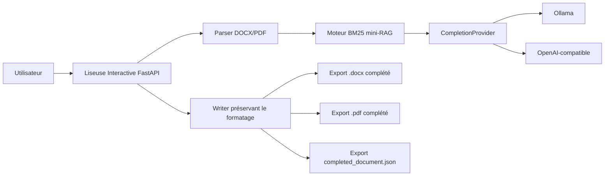

# DocuWriter

DocuWriter complète des zones `<here>...</here>` dans des documents Word et
PDF avec un fournisseur Ollama ou OpenAI-compatible. Le document source n'est
jamais modifié : le résultat est écrit dans
`output/completed_<nom_original>.<ext>` et le rapport dans
`output/completed_document.json`.

## Architecture

```text
src/docuwriter/
├── config.py       # configuration typée
├── models.py       # modèles de domaine
├── parser.py       # dispatch multi-formats
├── pdf_parser.py   # extraction PDF paginée
├── retriever.py    # mini-RAG BM25
├── llm_client.py   # adapters Ollama/OpenAI
├── pdf_writer.py   # rédaction PDF via PyMuPDF
├── writer.py       # dispatch DOCX/PDF
└── writer.py       # dispatch DOCX/PDF
```

## Architecture interactive



DocuWriter est une application 100 % interactive : les documents de contexte
et les documents à remplir sont déposés dans la liseuse FastAPI. Les fichiers
`.docx` et `.pdf` sont acceptés ; les fichiers Word temporaires `~$*.docx`
sont ignorés.

## Utilisation

```bash
uvicorn docuwriter.web:app --host 0.0.0.0 --port 8000
```

Ouvrez ensuite `http://localhost:8000` pour charger les piles de contexte et de
documents à remplir, annoter les zones et valider chaque itération.

Avec Docker :

```bash
docker compose up --build
```

## Configuration

Toutes les variables sont documentées dans [.env.example](.env.example).
Les valeurs importantes sont `LLM_PROVIDER`, `OLLAMA_HOST`, `OLLAMA_MODEL`,
`OPENAI_BASE_URL`, `OPENAI_API_KEY`, `BATCH_SIZE`, `MAX_CONTEXT_CHARS` et
`HIGHLIGHT_REPLACEMENTS`.

Le retriever calcule un score Okapi BM25 sur les chunks de contexte et les
sélectionne par pertinence dans la limite de caractères configurée. Les chunks
PDF conservent leur numéro de page et sont cités dans le contexte (`Page N`).
Les remplacements DOCX conservent le style des runs ; les remplacements PDF
sont réalisés in-place par coordonnées avec PyMuPDF et surlignés en jaune pâle.

## Démonstration 1-clic et liseuse

L'interface FastAPI permet de charger l'exemple avec **Charger un exemple de
démo**. Deux contextes réalistes et un modèle `DAT_Template_Cloud.docx` balisé
avec `<here>...</here>` sont alors générés sans préparation préalable. Chaque
proposition est éditable, peut être régénérée individuellement, puis exportée
en Word final avec le rapport JSON. Les modèles balisés peuvent aussi être
exportés et réutilisés comme documents d'entrée classiques.

## Tests

```bash
PYTHONPATH=src python -m unittest discover -s tests -v
```
